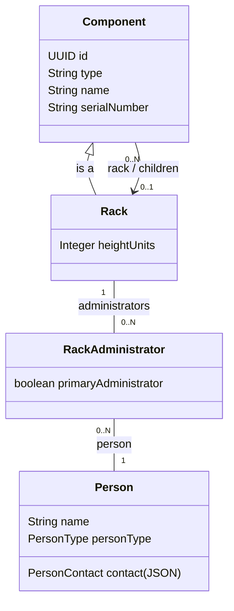
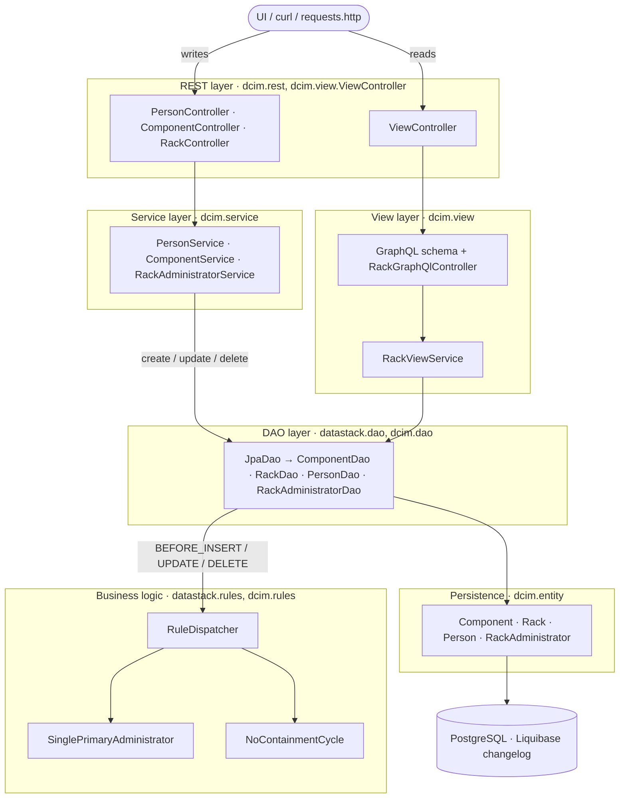
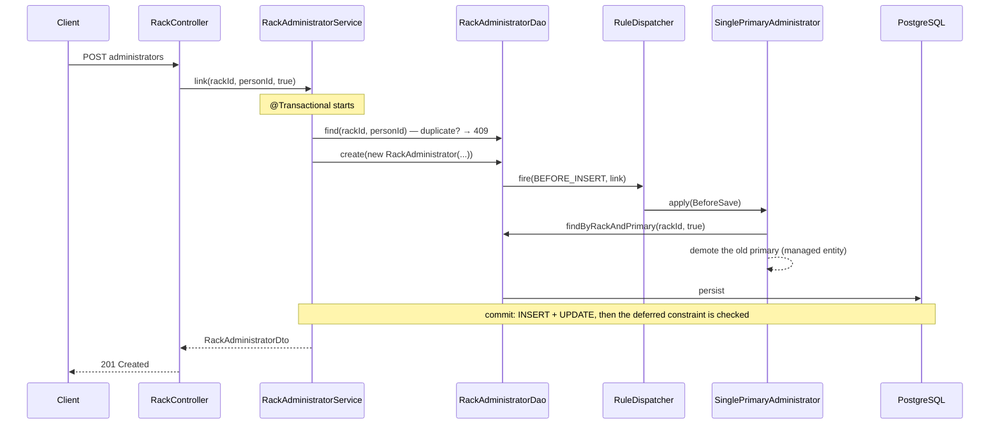
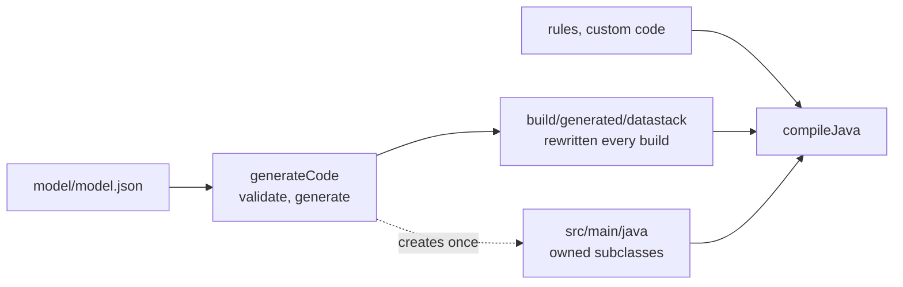

# Architecture — AixBOMS data stack, Phase 1

Phase 1 implements the target layering by hand for one use case, so that every layer can be tried out
before anything is generated. This document explains the layers, how a request flows through them, and what
changes in later phases.

**In Phase 1:** JPA, DAOs, business rules, GraphQL views, services and REST, all hand-written, on Spring Boot
and PostgreSQL.

**Not yet:** code generation from a model file, generation gap, customer projects, live deployment, the
VS Code designer, and the WildFly / JAX-RS adapter.

---

## 1. The use case



- **Component / Rack:** single-table inheritance in table `component`, with discriminator `type`
  (`COMPONENT`, `RACK`). Because a Rack is a Component, racks can sit inside racks.
- **RackChildren (1-to-N):** `component.rack_id` points at the rack. A rack with children cannot be deleted.
- **RackAdministrator (M-to-N with an attribute):** intersection table `rack_administrator` with
  `primary_administrator`. A rack has at most one primary administrator.
- **Person.contact** is a **JSON attribute**, stored in the dedicated `jsonb` column `ext`. Humans fill
  `email` and `phone`; AI agents fill `endpoint`.

---

## 2. Layers



| Layer | Package | Responsibility | Depends on |
| --- | --- | --- | --- |
| REST | `dcim.rest`, `dcim.view.ViewController` | HTTP mapping only: paths, status codes, validation of request bodies | Service, View |
| Service | `dcim.service` | Use cases; owns the transaction; returns DTOs, never entities | DAO |
| View | `dcim.view` | Read model: GraphQL schema, batched data access, views served as REST | DAO |
| DAO | `datastack.dao`, `dcim.dao` | The only way to write an entity; raises rule events; queries | JPA, rules |
| Business logic | `datastack.rules`, `dcim.rules` | `@Rule` classes reacting to DAO events | DAO (to look things up) |
| Persistence | `dcim.entity` | JPA mapping of tables, relations, JSON attributes | — |
| Database | `db/changelog/phase1.sql` | Tables, keys, constraints; Liquibase applies it at start-up | — |

The code is split into Gradle modules along the same line:

| Module | Contents | Depends on |
| --- | --- | --- |
| `datastack-runtime` | `com.aixpertsoft.datastack`: the **framework** (`Dao`, `JpaDao`, `@Rule`, `RuleDispatcher`, `ProblemHandler`). Knows nothing about racks. A plain library, no Spring Boot. | JPA API, Spring context / web / orm |
| `dcim-demo` | `com.aixpertsoft.dcim`: the **microservice** built on the runtime, plus the Spring Boot application | `datastack-runtime`, Spring Boot starters |
| `datastack-generator` | `com.aixpertsoft.datastack.generator`: validates `model.json` and generates a microservice from it. Plain Java, no Spring. | Jackson |
| `dcim-service` | The same microservice as `dcim-demo`, generated from `model/model.json`; only rules and custom code are hand-written | `datastack-runtime`, Spring Boot starters; `datastack-generator` at build time |
| `hogwarts-service` | A second generated microservice (Harry Potter wizards and spells) with no hand-written twin | same as `dcim-service` |

Because they are separate modules, `dcim-demo` can only use what the runtime exposes, and the runtime cannot
depend on any microservice by accident: the module boundary is checked by the compiler.

---

## 3. Write path: adding an administrator

`POST /api/racks/{rackId}/administrators {"personId": …, "primaryAdministrator": true}`



Points to notice:

- **Rules fire in the DAO, not in JPA listeners.** Every write path goes through a DAO, so rules run
  whatever service or endpoint caused the write. Later, jOOQ-based or non-SQL DAOs can raise the same
  events.
- **A rule refuses a change** by calling `event.reject(code, message)`. The transaction rolls back and the
  client gets `422` with that code.
- **The database is the last line of defence.** "One primary per rack" is also a PostgreSQL constraint,
  so even a bug or a direct SQL update cannot create two primaries.

---

## 4. Business rules

```java
@Rule(on = RackAdministrator.class, events = {BEFORE_INSERT, BEFORE_UPDATE}, order = 100)
public class SinglePrimaryAdministrator {
    public SinglePrimaryAdministrator(RackAdministratorDao links) { ... }   // rules are Spring beans
    public void apply(BeforeSave<RackAdministrator> event) { ... }
}
```

- The annotation is the rule's only metadata. There is no separate descriptor file.
- `RuleDispatcher` collects all `@Rule` beans, sorts them by `order` (then by name), and calls those whose
  `on` matches the entity (subclasses included) and whose `events` include the current event. It logs every
  rule at the first write, which is an easy way to see what is active.
- Events run **inside the transaction, before the SQL is sent**: `BEFORE_INSERT`, `BEFORE_UPDATE`,
  `BEFORE_DELETE`. After-commit events come later.
- Rules are tested without Spring or a database; see `SinglePrimaryAdministratorTest`, which uses an
  in-memory DAO.

### The two rules

| Rule | On | Behaviour |
| --- | --- | --- |
| `SinglePrimaryAdministrator` | `RackAdministrator` insert / update | Making someone primary demotes the current primary instead of failing |
| `NoContainmentCycle` | `Component` insert / update (racks included) | Rejects placing a rack inside itself, directly or through other racks (`dcim.containmentCycle`) |

### Deviation from the design doc: deferred constraint

The design doc enforced "one primary per rack" with a partial unique index, and had the rule flush the
demotion first. That is not enough when an existing link is *updated* to primary, because the promotion is
also pending in the same flush, and Hibernate's write order would decide whether it works.

Phase 1 uses a PostgreSQL **exclusion constraint that is `DEFERRABLE INITIALLY DEFERRED`** instead:

```sql
ALTER TABLE rack_administrator
  ADD CONSTRAINT ex_rack_primary_administrator
  EXCLUDE USING btree (rack_id WITH =) WHERE (primary_administrator)
  DEFERRABLE INITIALLY DEFERRED;
```

It is checked at commit, so the rule simply changes the flag on the old primary, with no flush and no
ordering concerns. The generator should produce this for "unique where" constraints on intersection
attributes.

---

## 5. Read path: the RackOverview view

`GET /api/views/rack-overview?page=0&size=20&name=LYO%25`

1. `ViewController` loads the stored query `graphql-documents/RackOverview.graphql` and runs it in-process
   through Spring for GraphQL. **The client never speaks GraphQL**; it gets plain JSON with
   `page`, `size`, `total` and `items`.
2. `RackGraphQlController` resolves `racks` and `rackCount` with one query each.
3. `children` and `administrators` are `@BatchMapping`s: Spring collects every rack in the response and asks
   for all their children (and all their administrators) **in one call each**.
4. `RackViewService` turns those calls into one SQL query per level, using `ComponentDao.findChildrenOfRacks`
   and `RackAdministratorDao.findByRacks` with a `join fetch` on the person.

Result: **4 SQL statements per call, whatever the page size**: count, racks, administrators with persons,
children. Check it with `--logging.level.org.hibernate.SQL=debug`.

Design choices:

- **Views return records (`ViewNodes`), never JPA entities.** No lazy loading outside a transaction, and
  no hidden N+1 queries.
- **GraphQL is the view definition language, not the write API.** Writes go through REST and the service
  layer, so they always pass through DAOs and rules.
- The same schema is available at `/graphql`, with GraphiQL at `/graphiql`, for exploring and building
  new views.
- `RackViewService` is the hand-written form of the **data-source contract** from the design doc: `racks`
  is `fetchRoots`, and `children` / `administrators` are `fetchByParentKeys`. Later, these methods are
  generated or provided by pluggable providers (JPQL, jOOQ, REST, sensors).

---

## 6. Persistence details

| Topic | Phase 1 choice |
| --- | --- |
| Schema ownership | Liquibase (`phase1.sql`); Hibernate only validates (`ddl-auto: validate`) |
| Keys | UUIDs generated by Hibernate |
| Optimistic locking | `@Version` on every entity; clients may send `version` with updates (409 if stale) |
| Inheritance | Single table with discriminator; the discriminator is also mapped read-only as `type` |
| Intersection | Always an entity (`RackAdministrator`), never `@ManyToMany`, so attributes can be added later without breaking anything |
| JSON attributes | Record `PersonExt` in `jsonb` column `ext`, mapped with `@JdbcTypeCode(SqlTypes.JSON)`; typed accessor `getContact()` |
| Open session in view | Off: entities never leave the service layer |
| Rack lookups | `RackDao.get` queries by type, so a component id passed where a rack is expected gives 404 |

---

## 7. Errors

`datastack.web.ProblemHandler` maps exceptions to `application/problem+json` with a stable `code`:

| Source | Status | Code |
| --- | --- | --- |
| `RuleViolation` from a rule | 422 | the rule's code, e.g. `dcim.containmentCycle` |
| `ApiException` from a service | as given | e.g. `dcim.rackNotEmpty`, `dcim.duplicateAdministrator` |
| `NotFoundException` from a DAO | 404 | `notFound` |
| Optimistic locking failure | 409 | `concurrentModification` |
| Bean validation | 400 | `validation` |
| Known database constraints | 409 | mapped by constraint name |

---

## 8. From Phase 1 to the target architecture

| Phase 1 (hand-written) | Later |
| --- | --- |
| Entities, DAOs, DTOs, controllers, GraphQL schema | Generated from `model.json` (generation gap: regenerated `…Base` classes plus developer-owned subclasses) |
| `phase1.sql` | Generated Liquibase changelog per model version |
| `@Rule` classes | Stay hand-written, unchanged |
| `datastack-runtime` module | Published as the shared runtime library used by every microservice |
| `datastack-generator` module (validates `model.json`) | Generates the code above; wrapped in a Gradle plugin (`generateCode`) |
| `RackViewService` | Generated resolvers on the data-source contract; pluggable providers |
| `ViewController` | Generic: one endpoint per view declared in the model |
| Spring MVC on Spring Boot | Thin web adapter; a JAX-RS adapter for WildFly next to it |
| One project | Base and customer microservice projects, merged by an assembly build |

The aim of Phase 1 is to settle what the generated code should look like, by writing it by hand once. Things
worth checking while reviewing:

- Is the DAO API (`Dao`, `JpaDao`) the right contract for rules and services?
- Are `@Rule`, `BeforeSave` and `RuleDispatcher` comfortable to write and test against?
- Does the view approach (stored GraphQL query, batch mappings, records) scale to the real Verios views?
- Is the REST shape (relationship endpoints, partial updates, error codes) what the UI needs?

---

## 9. The generator (`datastack-generator` → `dcim-service`)

The **model** (`dcim-service/model/model.json`) is the source of truth for tables, entities, relations and
views. **Custom code** is the source of truth for business rules and custom logic. The generator runs before
every compile, so the Java compiler reports any mismatch between the two.



| Layer | Generated (`…Base`, rewritten) | Owned (created once) |
| --- | --- | --- |
| Database | Liquibase changelog: tables, checks, unique and deferred exclusion constraints, FKs | `db.changelog-master.yaml`, `custom.sql` |
| Persistence | `orm.xml` (entities, tables, inheritance) and `*Base` mapped superclasses | Entity classes without annotations |
| DAO | `*DaoBase`: CRUD plus finders per reference | `*Dao`: custom queries |
| Service | `*ServiceBase`: CRUD, delete checks, relationship operations, error codes | `*Service`: overrides |
| REST | `*ControllerBase`, DTOs and requests with validation | `*Controller`: extra endpoints |
| View | Node records, JPQL view service, GraphQL schema and resolvers, `ViewsController` | — |
| Business logic | — | `@Rule` classes (written by hand) |

Design choices:

- **Generation gap instead of protected regions.** The generator never merges code: generated classes are
  rewritten, owned classes are never touched. Customising means overriding or adding in the subclass.
- **Mapping in `orm.xml`.** Owned entity classes carry no JPA annotations, so renaming a table or changing
  a discriminator in the model never leaves them out of date.
- **Views feed GraphQL.** A view is a root JPQL query with links: query links are batched by parent ids,
  path links follow fetched references. Each view becomes GraphQL types, a query field, `@BatchMapping`
  resolvers and a REST endpoint.
- **Error codes from names.** `dcim.rackNotEmpty`, `dcim.duplicateAdministrator`, … come from object and
  relation names, so clients see the same codes as with the hand-written demo.

Proof: `GeneratedRackApiIntegrationTest` is the demo's API test, unchanged, and passes against the generated
service. The view costs the same 4 SQL statements.

### A second model: `hogwarts-service`

`dcim-service` proves the generator reproduces hand-written code. `hogwarts-service` proves it works on a model
nobody wrote by hand first: House → Wizard (one-to-many, restrict), `Professor extends Wizard`, and
**Wizard ↔ Spell many-to-many with attributes** on the intersection (`level` 1–9 required, `favourite` at most
once per wizard). The hand-written part is two rules, one DAO query and the demo data.

Building it surfaced a few generator and runtime gaps, now fixed for every model:

| Gap | Fix |
| --- | --- |
| The link and update-link requests of a many-to-many had no validation | `@Min`/`@Max`/`@NotNull` from the intersection attributes, `@Valid` on the endpoint |
| Enum names: `Spell.category` became a bare `Category` | `<Object><Attribute>` (`SpellCategory`), unless the attribute already starts with the object name (`PersonType`) |
| A view on a supertype could not show subtype attributes (`Professor.subject` in `WizardOverview`) | Allowed; resolved with `instanceof`, nullable in GraphQL |
| The `uniqueWhere` constraint gave a generic code (`dcim.rackAdministratorConstraint`) | Optional `code` and `message` on `uniqueWhere` (`hogwarts.oneFavouriteSpell`); mapping uses the exact constraint name |
| A malformed body or unknown enum value returned Spring's default 400 without a `code` | `ProblemHandler` returns `400 unreadable` with the first line of the parser's message |

Each view costs 3 selects per request whatever the row count (root, count, one batched query per query link).

## 10. Known simplifications (Phase 1 demo)

- No security or ACL: all endpoints are open.
- `BeforeSave` does not yet expose old values (`changed(attribute)` from the design doc). `NoContainmentCycle`
  simply checks every save.
- Rules run synchronously; no after-commit or async events yet.
- No jOOQ yet; all access is JPA.
- No OpenAPI spec or TypeScript client yet.
- Views are hard-wired to one REST endpoint each.

---

## 11. Open decisions

### Inheritance strategy (decided for now: single table, revisit later)

Phase 1 keeps **single-table inheritance**: `Component` and `Rack` share table `component`, told apart by the
`type` discriminator. This is the choice until more component types are modelled.

To revisit because AixBOMS has **hundreds of component types**:

- **Joined inheritance** (one table per subtype) gives clean tables and `NOT NULL` on subtype columns, but a
  polymorphic query such as "all components in rack X" makes Hibernate outer-join every subtype table.
  With hundreds of types that does not scale.
- **Single table** stays fast, but every subtype column must be nullable and the table grows wide and sparse.
- **Type as data**: one entity class, the type is a value pointing to a type definition, and type-specific
  attributes live in the `jsonb` column. This is how most CMDBs handle a long tail of types; new types need
  no new code.

Likely end state: a per-hierarchy option in `model.json` (`singleTable`, `joined`, `typeAsData`), with a few
important component types (Rack, Server, Switch) as real subclasses and the long tail as type-as-data.
Persons (HUMAN / AI) can become single-table subclasses later without a schema change: `person_type` becomes
the discriminator.
