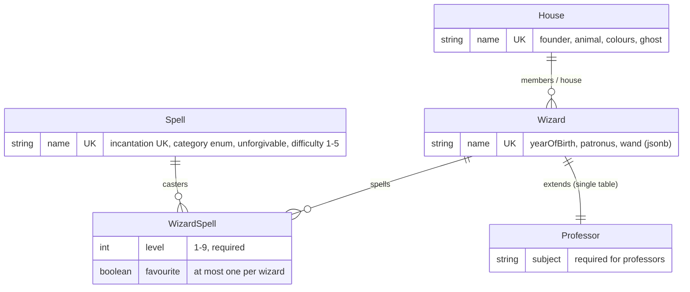

# hogwarts-service — Wizards and Spells, generated from a model

A second microservice generated by `datastack-generator`, with a more entertaining data model than racks:
the wizards, houses and spells of the Harry Potter books. It shows the generator on a fresh model, with
**no hand-written twin** to copy from. Everything below `build/generated` comes from
[`model/model.json`](model/model.json); the hand-written code is two rules, one DAO query and the demo data.

## The model



| Model feature | Where it shows |
| --- | --- |
| **Many-to-many with attributes** | `WizardSpell`: `level` 1–9 (required) and `favourite`, on the intersection table `wizard_spell` |
| "One per parent where flag" | `uniqueWhere` on `favourite` → deferred exclusion constraint `ex_wizard_spell_wizard_id`, error code `hogwarts.oneFavouriteSpell` |
| Inheritance | `Professor extends Wizard`, single table `wizard`, discriminator `type`; `subject` is required only for professors (check constraint) |
| One-to-many with restrict | `House` → `Wizard` (`members`); deleting a house with members gives `409 hogwarts.houseNotEmpty` |
| Enum | `Spell.category`: CHARM, JINX, HEX, CURSE, HEALING → `SpellCategory` |
| JSON attribute | `Wizard.wand` (`wood`, `core`, `lengthInches`) in the `ext` jsonb column |
| Ranges, defaults, uniques | `level` 1–9, `difficulty` 1–5, `yearOfBirth` 1000–2100, `unforgivable` defaults to false, unique names and incantations |

### Views

| View | REST | Shape | SQL |
| --- | --- | --- | --- |
| `WizardOverview` | `/api/hogwarts/views/wizard-overview?name=%harry%` | wizard → house (path link) → spells (batched query link) → spell (path link) | 3 selects |
| `SpellBook` | `/api/hogwarts/views/spell-book?name=avada%` | spell → casters → wizard → house: the many-to-many read from the other side | 3 selects |
| `HouseRoster` | `/api/hogwarts/views/house-roster` | house → members, professors and students mixed | 3 selects |

The SQL count is per request, whatever the number of rows: root query, count, one batched query per query link.
Each view is also a GraphQL field in the model's namespace, `{ hogwarts { wizardOverview { ... } } }`, at
`/graphql` (GraphiQL at `/graphiql`). GraphQL types are prefixed `Hogwarts`; tables live in schema `hogwarts`.

## Custom code

| File | What it does |
| --- | --- |
| `rules/SingleFavouriteSpell` | Making a spell the favourite demotes the previous favourite instead of failing. Uses the custom query below. |
| `rules/UnforgivableCursesNeedPower` | An Unforgivable Curse needs level 7 or more, otherwise `422 hogwarts.unforgivableTooWeak`. A rule that combines an intersection attribute with a flag on the linked entity, which the model alone cannot express. |
| `dao/WizardSpellDao.findFavourites` | Custom JPQL query in the owned DAO subclass |
| `demo/DemoData` | 4 houses, 16 wizards and professors, 22 spells and 53 links from the books. Loaded through the generated services, so the rules run on the seed too. `demo.seed=false` switches it off. |

## Run it

```bash
./gradlew :hogwarts-service:bootRun      # starts PostgreSQL from compose.yaml (port 15434), generates, compiles, runs
curl "http://localhost:8080/api/hogwarts/views/wizard-overview?name=%25harry%25"
```

Without Docker, create a database `hogwarts` (user and password `hogwarts`) and run with
`SPRING_DOCKER_COMPOSE_ENABLED=false`. Next to the other services, change the port:
`SERVER_PORT=8083 ./gradlew :hogwarts-service:bootRun`.

To run it next to other models on one server instead: `./gradlew :hogwarts-service:deploy`, then start
[`datastack-server`](../datastack-server/README.md).

[`requests.http`](requests.http) walks through the API: views, GraphQL, the favourite swap and every error.

## Try the rules

```bash
B=http://localhost:8080/api/hogwarts
# Neville tries the Cruciatus Curse at level 3
curl -X POST -H 'Content-Type: application/json' -d '{"spellId":"<crucio-id>","level":3}' $B/wizards/<neville-id>/spells
# -> 422 {"code":"hogwarts.unforgivableTooWeak","detail":"Cruciatus Curse needs level 7 or more: you need to really mean it"}

# Harry's favourite becomes the Patronus Charm; Expelliarmus stops being the favourite
curl -X PATCH -H 'Content-Type: application/json' -d '{"favourite":true}' $B/wizards/<harry-id>/spells/<patronus-id>
```

| Request | Result |
| --- | --- |
| Link with `level` 10 | `400 validation`: level must be less than or equal to 9 |
| Link a spell twice | `409 hogwarts.duplicateSpell` |
| Professor without `subject` | `400 validation` |
| Spell with `category` PRANK | `400 unreadable` (lists the accepted values) |
| Delete a house with members | `409 hogwarts.houseNotEmpty` |
| Two favourites written straight to the database | rejected at commit by `ex_wizard_spell_wizard_id` |

## Tests

`HogwartsApiIntegrationTest` starts the service with the demo data and checks the views, inheritance, the
favourite swap, the unforgivable rule, ranges, duplicates, restrict-delete and enum errors. It uses
Testcontainers, or set `HOGWARTS_TEST_DB_URL` to an empty database (wiped first):

```bash
HOGWARTS_TEST_DB_URL=jdbc:postgresql://localhost:5432/hogwarts_test ./gradlew :hogwarts-service:test
```

Generated and owned files work as in `dcim-service`; see [its README](../dcim-service/README.md).
